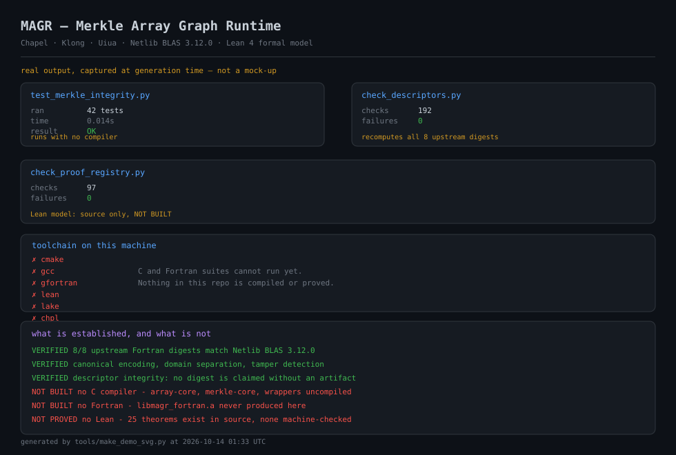
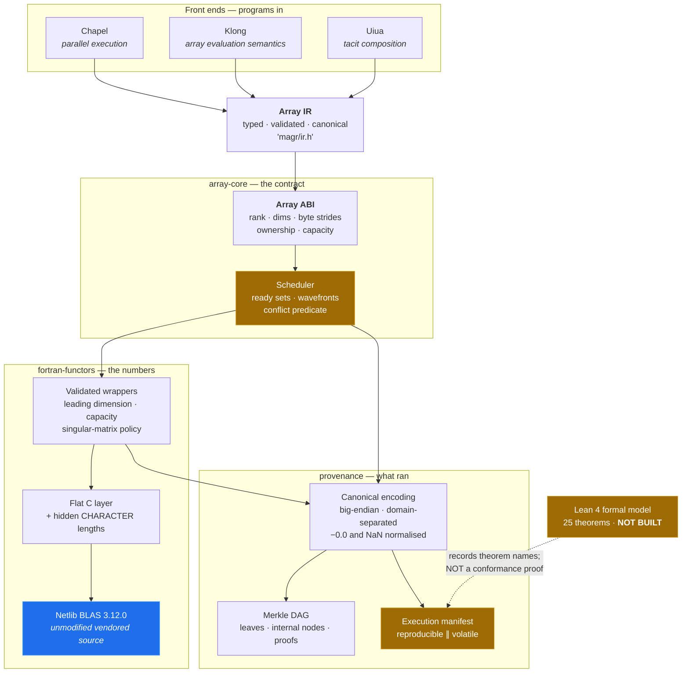
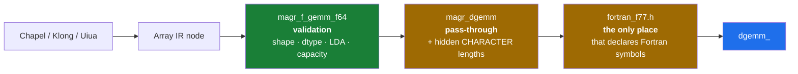
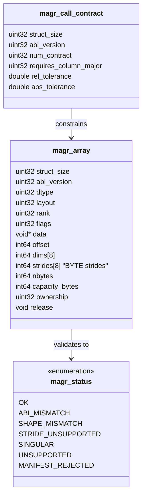
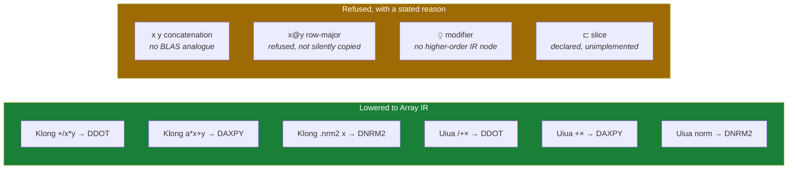
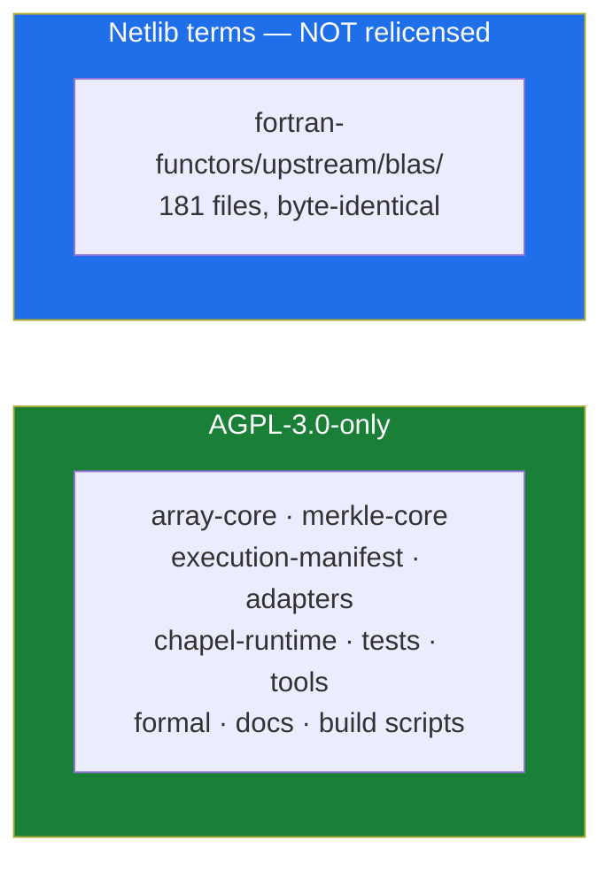

<div align="center">

# MAGR

### Merkle Array Graph Runtime

**Chapel · Klong · Uiua · Netlib BLAS 3.12.0 · Lean 4 formal model**

[](LICENSE)
[](array-core/include/magr/abi/array_abi.h)
[](fortran-functors/upstream/)
[](formal/artifacts/proof_registry.json)
[](STATUS.md)
[](STATUS.md)



> **Read this first.** No C, Fortran, or Lean code in this repository has been
> compiled. The badges say so, the terminal image says so, and
> [`STATUS.md`](STATUS.md) says so in detail. What *has* been verified is listed
> below, and it is smaller than what has been written.

</div>

---

## What this is

MAGR is an array-native computational runtime that keeps the numerical algorithms
that have been correct for fifty years and replaces the execution infrastructure
around them.

The numerical backbone is the **unmodified reference BLAS from Netlib** — version
3.12.0, vendored byte-for-byte into `fortran-functors/upstream/blas/`, with all
181 files covered by SHA-256 digests. Those routines are compiled from their
original Fortran 77 source. Nothing in the repository re-implements DDOT, DGEMV,
DGEMM, DGER, DTRSV or DTRSM, because a hand-rolled replacement would be strictly
worse than a fifty-year-old one that has been checked by every numerical
computing group on earth.

Around that, MAGR supplies the parts that did not exist for Fortran:

- **A language-neutral Array ABI** so that Chapel, Klong and Uiua can all call
  the same numerical kernels without knowing about column-major storage or
  Fortran calling conventions.
- **A typed Array IR** that all three front ends lower into, so an operation that
  one language can express and another cannot becomes a *structural* fact about
  the program rather than a runtime surprise.
- **A scheduler** that refuses to run two operations against the same memory
  concurrently, and says so out loud when it cannot parallelise.
- **A cryptographic provenance layer** — canonical encoding, SHA-256 content
  addressing, a Merkle DAG, and execution manifests — so that what ran can be
  checked later by someone who was not there.

And a **Lean 4 formal model** of the numerical contracts, with a
content-addressed proof registry.

### What the Merkle layer does and does not prove

This distinction runs through the entire codebase and is worth stating in the
README rather than only in a header comment:

> **A valid Merkle root proves the integrity of committed data. It does not
> prove that the data is correct.**

A program that computes the wrong answer and then faithfully commits the wrong
answer produces a perfectly valid root. Numerical correctness is established
separately, by conformance tests against a reference implementation. Conflating
the two is the most common way a "we have a Merkle tree, therefore it is
verified" system comes to be believed when it has not been verified.

The same logic applies to the formal layer. A Lean theorem about the model is a
statement about the model. It is not a statement about `libmagr_blas.a`. See
[`formal/MagrFormal/Disclaimer.lean`](formal/MagrFormal/Disclaimer.lean).

---

## Architecture



### The layered call path into Fortran

There is exactly **one** path from C into Fortran, and it has four layers. This
is not architectural decoration — it is the direct consequence of a bug that was
caught during integration.



The third layer exists because **Fortran 77 passes the declared length of every
`CHARACTER` dummy argument as a trailing hidden argument**. `DGEMV`'s `TRANS` is
`CHARACTER*1`, so a correct call passes *twelve* arguments, the twelfth being the
value `1`. An integrated Phase 1–3 patch declared and called it with eleven.

That is undefined behaviour. On x86-64 System V it very often appears to work,
because the missing argument would have occupied a register the callee does not
read — which is precisely why it would have survived testing. It is not
guaranteed on any ABI and it is guaranteed to break on any toolchain that lays
out character lengths differently. The failure mode is not a crash; it is a
plausible wrong answer. See [`docs/INTEGRATION-NOVA.md`](docs/INTEGRATION-NOVA.md) §3.1.

---

## Verification status

This is the part of the README that matters most, so it is a table rather than
prose.

### Established — has actually been run

| Claim | Evidence |
|---|---|
| Upstream source is Netlib BLAS 3.12.0, unmodified | 8/8 `source_digest` values recomputed against the independently vendored archive — **all match** |
| Vendored sources are byte-identical to upstream | 181/181 files verified against `blas-3.12.0.sha256` |
| Canonical encoding behaves as specified | 42/42 tests — framing, domain separation, `−0.0` and NaN normalisation, tamper detection |
| Merkle proof side semantics are correct | inclusion proofs verify for every leaf; a real bug found and fixed here (see below) |
| Descriptors claim nothing they have not established | 200/200 checks — every `binary.digest` and `conformance.results` is `null` with a stated reason |
| Proof registry matches its Lean sources | 97/97 checks, both directions, digests recomputed |

### Not established

| Claim | Why not |
|---|---|
| The C tree compiles | no C compiler on the development machine |
| The Fortran backend builds | no Fortran compiler; `libmagr_fortran.a` was never produced here |
| 25 Lean theorems are proved | no Lean toolchain; `build.status` is `NOT BUILT` and no `.olean` digest is claimed |
| Chapel / Klong / Uiua run | none of the three toolchains is installed |
| `libmagr_blas.a` digest `2627f29b…` | the artifact was never supplied; recorded as a claim, unverified |
| 28 BLAS + 97 ABI/runtime tests pass | reported by an external Phase 1–3 build on a different machine; carried as a claim, not a result of this repository |

### Bugs this repository found in its own code

Recording these is the most useful part of the table, because a project that
only reports its wins is not reporting accurately.

- **The Merkle inclusion proof recorded the sibling's side while verification
  read the subject's side.** Proofs failed to verify. Real bug, found by the
  test suite, fixed in both the C and Python implementations, with a dedicated
  regression test.
- **Three GEMM test expectations used `2·6 + 4·8 = 50`.** It is **44**. All three
  were wrong and would have failed. Found by re-deriving every expected value
  with an independent Python implementation rather than by reading the code.
- **A test asserted on padding.** `test_gemm_leading_dimension` checked `c[2]`
  and `c[3]`, which are padding under `LDC = 4`. Asserting on padding is
  precisely how a wrong-leading-dimension bug hides.
- **The proof-registry generator read the word "theorem" inside prose.** A
  docstring saying *"Every theorem below carries…"* created a phantom theorem
  named `below`, and a dict comprehension silently collapsed the duplicate so the
  counts disagreed with no error raised. Comments are now stripped before
  scanning, and a duplicate-name check guards the collapse.

---

## Canonical encoding

Every content-addressed thing goes through one encoding, specified normatively in
[`merkle-core/include/magr/canonical.h`](merkle-core/include/magr/canonical.h).

| Property | Rule | Why |
|---|---|---|
| Integers | big-endian, fixed width | a digest computed on x86-64 compares with one computed on a big-endian target with no conversion step someone might forget |
| Variable-length fields | `u64` byte-length prefix | without this, `("ab","c")` and `("a","bc")` collide, and two different descriptors share a commitment |
| Domain separation | 4-byte tag + version on every structure | so a leaf can never be replayed as an internal node, and an input commitment can never be presented as an output commitment |
| `f64` | IEEE-754 bits, big-endian, after normalisation | `−0.0 → +0.0`, all NaNs → canonical quiet NaN `0x7FF8000000000000` |
| Strings | length-prefixed UTF-8 | byte order is preserved, so the canonical form is a function of the bytes |

The normalisation rules deserve a note, because the opposite choice was
considered and rejected. Preserving `-0.0` and NaN payloads makes the digest a
function of *how the CPU behaved* rather than of *what the program computed*:
`0.0 · −1.0` is `−0.0` and `x − x` is `+0.0`, so two runs of the same program can
disagree. NaN payload bits are not architecturally determined at all. Infinities
are explicitly **not** caught by the NaN rule.

Array *payload* bytes are hashed raw, not normalised — the payload is data, and
normalising it would change the committed data rather than describe it. This is
why `+0.0` and `−0.0` in an output block produce different commitments while two
logically identical metadata blocks do not.

---

## The Array ABI

Versioned, self-describing, and strict. Full specification in
[`array-core/include/magr/abi/array_abi.h`](array-core/include/magr/abi/array_abi.h).



Five decisions that are load-bearing:

1. **Self-description.** Every struct carries `struct_size` and `abi_version`. A
   callee receiving a descriptor from a mismatched caller *rejects* it instead
   of misreading fields. This is what makes a cross-language boundary safe to
   evolve.
2. **Byte strides, not element strides.** A view can express an `f64` matrix over
   an `f32` buffer without lying about the element type. Element strides force
   every stride computation to remember to multiply by the element size, which is
   a bug factory.
3. **`capacity_bytes` with enforcement.** Without it, a descriptor claiming a
   100×100 matrix over a 100-element buffer validates fine and then corrupts
   memory inside DGEMM.
4. **Explicit ownership.** `BORROWED`, `OWNED` (with a release hook), or `VIEW`.
   Passing a struct transfers at most a borrow; taking ownership is a separate,
   explicit call.
5. **Errors are returned, never thrown**, and never signalled via `errno`.
   Numerical routines that cannot return a status — `DDOT` — report failure
   through MAGR wrappers that pre-validate every argument.

### Why leading-dimension checks matter so much

Reference BLAS does **not** validate `LDA`. `DGEMM` reads `A(LDA,*)`
unconditionally. A wrong leading dimension is not an error return; it is a silent
out-of-bounds read and write that returns plausible numbers. The conformance
suite therefore uses **poisoned padding** — filler set to values that would
visibly corrupt the result if they were ever read — and asserts on the padding
explicitly.

---

## Supported language subsets

Both adapters implement a documented subset and **refuse everything else** with a
specific status. Refusal is the feature: *"unsupported operations fail
explicitly"* is in the specification precisely because a runtime that guesses is a
runtime that is wrong without saying so.



Adapters return human-readable diagnostics, not bare status codes:
`magr_klong_unsupported_reason("x y")` returns *"concatenation, which has no
BLAS analogue and is not implemented. MAGR will not pretend it is a dot
product."*

Two policies are worth calling out because they are easy to get wrong and hard to
notice:

- **Row-major matrices are refused by the Fortran functors**, not silently
  transposed and copied. A silent copy would hide a mis-lowered front end and
  change the cost model underneath the caller.
- **Mismatched-length `dot` and `axpy` are undefined in the Lean model too**, not
  modelled with an invented behaviour. An earlier draft invented
  `axpy α xs [] = α·xs`; the runtime returns `SHAPE_MISMATCH` and never reaches
  Fortran. A model that accepts a program the runtime rejects buries exactly the
  mismatch a refinement proof would have to discharge.

---

## Repository layout

```mermaid
flowchart TB
    ROOT["MAGR/"]
    ROOT --> AC["array-core/<br/>types · shapes · byte strides · ABI · IR"]
    ROOT --> FF["fortran-functors/<br/>wrappers · flat C layer · descriptors"]
    ROOT --> UP["fortran-functors/upstream/blas/<br/><b>181 unmodified files</b>"]
    ROOT --> CH["chapel-runtime/<br/>executor · scheduler entry points"]
    ROOT --> KL["klong-adapter/"]
    ROOT --> UI["uiua-adapter/"]
    ROOT --> MC["merkle-core/<br/>SHA-256 · canonical encoding · DAG"]
    ROOT --> EM["execution-manifest/<br/>reproducible ∥ volatile"]
    ROOT --> FM["formal/<br/>Lean 4 model · generated registry"]
    ROOT --> TS["tests/<br/>abi · array · fortran · merkle"]
    ROOT --> TL["tools/<br/>verify · check · generate"]
    ROOT --> DC["docs/"]
```



## Building

There is no compiler on the machine this was written on, so nothing here has been
built. To build it:

**Windows (MSYS2, recommended):**

```powershell
winget install -e --id MSYS2.MSYS2
# then, in an MSYS2 UCRT64 shell:
pacman -S --needed mingw-w64-ucrt-x86_64-gcc \
    mingw-w64-ucrt-x86_64-gcc-fortran mingw-w64-ucrt-x86_64-cmake

./build.ps1
```

**Anywhere with CMake ≥ 3.16:**

```bash
cmake -S . -B build -DCMAKE_BUILD_TYPE=Release
cmake --build build
ctest --test-dir build --output-on-failure
```

**The suites that need no compiler — these are the ones that ran:**

```bash
python tests/merkle-integrity/test_merkle_integrity.py   # 42 tests
python tools/check_descriptors.py                        # 200 checks
python tools/check_proof_registry.py                     # 97 checks
python tools/apply_license_headers.py --check            # 47 files
```

`-ffp-contract=off` is applied to the Fortran build **by default**, and the choice
is recorded in every execution manifest. With contraction enabled the compiler
may fuse `a·x + y` into an FMA, which changes the rounding and therefore the
output bits. That is a legitimate optimisation and a disqualifying reproducibility
hole; it is off here, and `MAGR_F77_FP_CONTRACT_OFF` lets a program state plainly
whether it can promise bit-identity.

---

## The formal model

25 theorems over exact rationals, in [`formal/`](formal/). Zero external
dependencies — a formal layer that needs Mathlib will not build on the machine
that needs to check it.

The carrier type is `Rat` rather than IEEE-754 binary64, and that is a deliberate
trade with a cost worth stating: the algebraic laws become *exactly* true, and
they are **not** exactly true over binary64. `axpy_fusion` — the formal basis for
the Phase 5 AXPY fusion optimisation — says

```
axpy β xs (axpy α xs ys) = axpy (α+β) xs ys
```

which holds over ℚ and fails numerically over binary64, because `(α+β)·x` rounds
once while `β·x + α·x` rounds twice. The runtime must therefore treat fusion as a
tolerance-dependent equivalence and **measure** it. This is recorded in the
proof's docstring rather than left for someone to discover.

`formal/artifacts/proof_registry.json` is **generated**, never hand-edited. A
hand-written registry listed `ArrayModel.nelems_rank0` — a theorem that did not
exist. `tools/check_proof_registry.py` cross-checks in both directions,
recomputes every source digest, and refuses to accept a `.olean` digest while no
Lean toolchain is present.

Two digests, and they are not the same kind of thing:

- **`source_sha256`** — sha256 of the `.lean` file. The stable identity of the
  statement plus its proof. **This is the digest a manifest should cite.**
- **`olean_sha256`** — sha256 of a compiled object. Depends on the Lean version,
  the elan toolchain path, and the build directory, so it changes without the
  mathematics changing. Build evidence only, never proof identity.

---

## Licence

AGPL-3.0-only. Full text in [`LICENSE`](LICENSE). Every first-party file carries
an SPDX identifier; `tools/apply_license_headers.py --check` verifies none has
rotted.



The vendored Fortran is **deliberately excluded** from the AGPL headers, and this
is not an oversight:

1. The specification requires the vendored sources to stay byte-identical to
   upstream. A header would change all 181 digests and break
   `tools/verify_upstream.ps1`.
2. Netlib's terms state: *"If you modify the source for these routines we ask
   that you change the name of the routine and comment the changes made to the
   original."* Adding a licence header **is** a modification, so doing it would
   put the project in breach of the attribution condition accepted at vendoring
   time.
3. The eight-digest verification in [`docs/INTEGRATION-NOVA.md`](docs/INTEGRATION-NOVA.md)
   §1 would be invalidated and could not be reproduced by anyone else.

Their terms are recorded verbatim in
[`fortran-functors/upstream/README.md`](fortran-functors/upstream/README.md), with
the Netlib licensing statement quoted rather than paraphrased. A repository with
mixed, correctly attributed licences is normal; one that silently relicenses
third-party code is not.

**AGPL section 13** matters if you run MAGR as a network service: offering it over
a network requires making the corresponding source of your modified version
available to those users. See [`docs/licensing.md`](docs/licensing.md).

---

## Documentation

| Document | What it covers |
|---|---|
| [`STATUS.md`](STATUS.md) | **Start here.** What ran, what did not, what was claimed by others |
| [`docs/INTEGRATION-NOVA.md`](docs/INTEGRATION-NOVA.md) | Phase 1–3 audit: six defects found, what was adopted and why |
| [`docs/INTEGRATION-PHASE4.md`](docs/INTEGRATION-PHASE4.md) | Phase 4 audit: why the submitted Merkle implementation was not adopted |
| [`docs/canonical-encoding.md`](docs/canonical-encoding.md) | The normative encoding specification |
| [`docs/merkle.md`](docs/merkle.md) | Node structure, folding scheme, publishing the root |
| [`docs/licensing.md`](docs/licensing.md) | AGPL obligations, Netlib attribution, vendored-code boundaries |
| [`docs/roadmap.md`](docs/roadmap.md) | What is left, in dependency order, with the blockers named |

## Contributing

Three rules, in priority order:

1. **Never claim a test passed unless it ran here.** The difference between a
   verified system and a believed one is entirely a difference in honesty about
   this.
2. **Never fill in a digest you have not computed.** Every descriptor ships with
   `binary.digest: null` and a stated reason. That is the correct state of
   knowledge, not an omission.
3. **Do not modify `fortran-functors/upstream/`.** Run
   `tools/verify_upstream.ps1` to confirm.

## Citation

The numerical routines are the Netlib Reference BLAS. Credit belongs to their
authors; see [`fortran-functors/upstream/README.md`](fortran-functors/upstream/README.md).

<div align="center">

**MAGR** — preserve the numerical algorithms, modernise the execution
infrastructure, make integrity independently verifiable.

**AGPL-3.0-only** · vendored Netlib BLAS 3.12.0 under its own terms

</div>