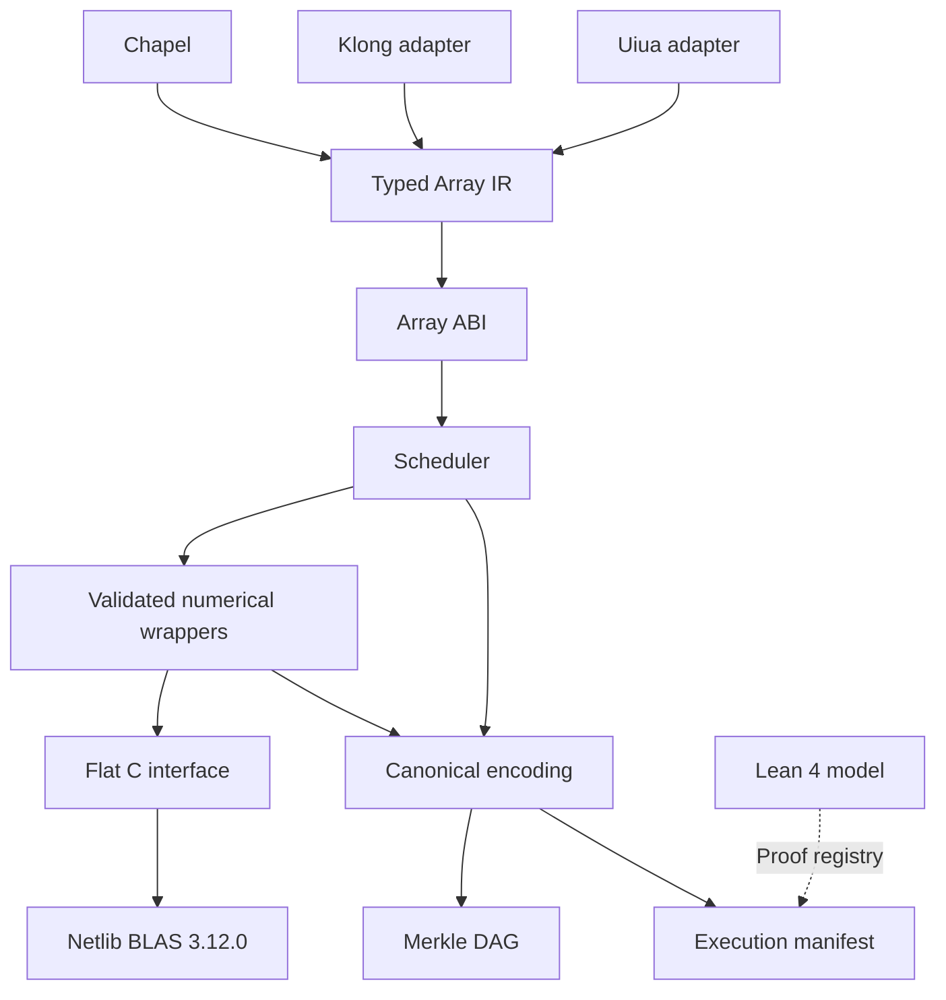

# MAGR

**Merkle Array Graph Runtime**

Chapel · Klong · Uiua · Netlib BLAS 3.12.0 · Lean 4

[](LICENSE)
[](array-core/include/magr/abi/array_abi.h)
[](fortran-functors/upstream/)

MAGR is an array runtime implemented by Ahmad Ali Parr on his own machine. It connects array-language front ends to numerical kernels through a shared Array ABI and typed intermediate representation, and records execution provenance using canonical encodings, content hashes, and a Merkle DAG.

The numerical backend uses vendored Netlib Reference BLAS 3.12.0. MAGR provides the wrappers, array contracts, scheduling, language adapters, and provenance infrastructure around those routines. A Lean 4 model describes the algebraic contracts.

## Architecture



The Array ABI carries dtype, rank, dimensions, byte strides, layout, capacity, and ownership information. Version and structure-size fields support validation at language boundaries. Numerical wrappers check array contracts before calling the Fortran backend and return status codes to callers.

The C-to-Fortran interface centralizes symbol declarations and the hidden `CHARACTER` length arguments required by the supported Fortran calling convention. The scheduler groups ready operations and checks memory conflicts before concurrent execution.

## Numerical operations and language adapters

The backend includes `DDOT`, `DAXPY`, `DNRM2`, `DGEMV`, `DGEMM`, `DGER`, `DTRSV`, and `DTRSM`.

The Klong and Uiua adapters lower supported operations to Array IR:

| Operation | Klong | Uiua | Backend |
|---|---|---|---|
| Dot product | `+/x*y` | `/+×` | `DDOT` |
| Scaled vector addition | `a*x+y` | `+×` | `DAXPY` |
| Vector norm | `.nrm2 x` | `norm` | `DNRM2` |

Unsupported operations return diagnostics. The Fortran functors require column-major matrices, and vector operations validate compatible lengths.

## Provenance

MAGR uses a shared canonical encoding for content-addressed metadata:

| Value | Encoding |
|---|---|
| Integers | Fixed-width, big-endian |
| Variable-length fields | `u64` byte-length prefix |
| Structures | Four-byte domain tag and version |
| Metadata `f64` values | IEEE-754 bits with signed zero and NaNs normalized |
| Strings | Length-prefixed UTF-8 |
| Array payloads | Original bytes |

Merkle roots and inclusion proofs support integrity checks on committed data. Numerical conformance tests assess computed results separately. Execution manifests record reproducible inputs and build information alongside volatile execution metadata.

See [canonical encoding](docs/canonical-encoding.md) and [Merkle structure](docs/merkle.md) for the formats.

## Build and test

The CMake build requires CMake 3.16 or newer, a C11 compiler, and a Fortran compiler for the numerical backend.

```bash
cmake -S . -B build -DCMAKE_BUILD_TYPE=Release
cmake --build build
ctest --test-dir build --output-on-failure
```

On Windows with the toolchain available in your PowerShell environment:

```powershell
.\build.ps1
```

Source and metadata checks can also be run independently:

```bash
python tests/merkle-integrity/test_merkle_integrity.py
python tools/check_descriptors.py
python tools/check_proof_registry.py
python tools/apply_license_headers.py --check
```

To check vendored source hashes:

```powershell
.\tools\verify_upstream.ps1
```

The build checks support for `-ffp-contract=off` and records compiler information for provenance. Build results depend on the selected toolchain and configuration. The checked-in [status record](STATUS.md) documents a particular validation environment; local build and test output provides results for your environment.

## Formal model

The [Lean 4 model](formal/) contains 25 theorem declarations over exact rational arithmetic and has no Mathlib dependency. It covers array and numerical contracts, including AXPY composition.

Rational algebra and floating-point evaluation have different rounding behavior. Optimizations based on the model therefore require numerical conformance checks under the runtime's tolerance policy.

The generated [proof registry](formal/artifacts/proof_registry.json) records theorem names and source digests. `source_sha256` identifies the Lean source; `olean_sha256`, when available, identifies a compiled artifact for a specific Lean build. The registry checker cross-checks theorem declarations and hashes.

## Repository layout

| Directory | Contents |
|---|---|
| `array-core/` | Array types, shapes, strides, ABI, IR, and scheduling |
| `fortran-functors/` | Numerical wrappers, C interface, and descriptors |
| `fortran-functors/upstream/blas/` | Vendored Netlib BLAS sources |
| `chapel-runtime/` | Executor and scheduler entry points |
| `klong-adapter/` | Klong lowering and diagnostics |
| `uiua-adapter/` | Uiua lowering and diagnostics |
| `merkle-core/` | SHA-256, canonical encoding, and Merkle DAG |
| `execution-manifest/` | Execution provenance records |
| `formal/` | Lean model and generated proof registry |
| `tests/` | Array, ABI, numerical, and integrity tests |
| `tools/` | Validation and artifact-generation tools |
| `docs/` | Specifications and development records |

## License and attribution

MAGR's first-party code is licensed under **AGPL-3.0-only**. See [LICENSE](LICENSE) for the full text and [licensing documentation](docs/licensing.md) for details.

The vendored Netlib BLAS sources retain their upstream terms and attribution. They are kept byte-identical to upstream and excluded from the first-party license-header tool. Credit for the numerical routines belongs to the Netlib BLAS authors; see the [upstream README](fortran-functors/upstream/README.md).

## Documentation and contributions

- [Canonical encoding](docs/canonical-encoding.md)
- [Merkle DAG](docs/merkle.md)
- [Roadmap](docs/roadmap.md)
- [Validation status record](STATUS.md)
- [Phase 1–3 integration notes](docs/INTEGRATION-NOVA.md)
- [Phase 4 integration notes](docs/INTEGRATION-PHASE4.md)

Contributions should include relevant test results and compute artifact digests from the corresponding files. Keep vendored upstream sources unchanged and run the applicable validation tools when updating descriptors or the proof registry.
